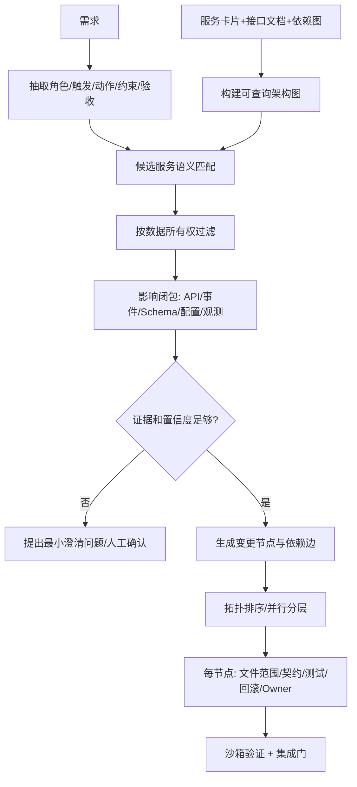
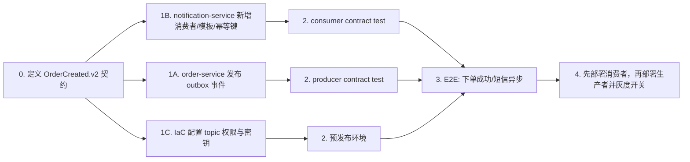

# AI Agent 跨微服务任务拆解设计

## 1. 问题定义

输入不是“需求文字 + 全仓库”这么简单。Agent 需要一套版本明确的系统事实：服务职责、拥有的数据、提供/消费的 API 与事件、部署单元、测试入口、代码 owners 和禁止依赖。输出必须是带证据的变更图，而不是一串猜测的服务名。

## 2. 服务卡片

先把技术文档标准化为 Service Card：

```yaml
name: order-service
owns: [Order, OrderStatus]
provides:
  - POST /orders
produces:
  - OrderCreated.v2
consumes: []
repositories: [services/order]
contract_tests: [contracts/order-created]
owner: commerce-team
```

每张卡带 `source_document + version + excerpt`，Agent 的每个判断必须引用卡片证据。文档互相冲突时停止自动改代码并列出冲突。

## 3. 拆解流水线



### 判断“改哪些服务”

1. 找到触发事实的 owner，而不是按关键词匹配代码。例如“下单后”对应 Order 状态的唯一所有者。
2. 找到动作能力 owner，例如短信供应商凭据只能属于 notification-service。
3. 沿架构图求影响闭包：新增事件是否影响 schema registry、消费者兼容性、IaC 权限、监控告警和前端状态。
4. 对纯消费者需求优先新增订阅，避免让订单服务直接依赖短信 SDK。
5. 每个候选输出“纳入原因”和“排除原因”。没有证据的候选不能自动修改。

### 判断并行与先后

建立 DAG，边表示可验证依赖：

- `contract → producer/consumer`：事件/API contract 先定稿；producer 和 consumer 可基于 contract mock 并行。
- `schema migration → code using field`：向后兼容迁移先部署，破坏性清理最后。
- `producer deploy → consumer enable`：若 consumer 不能处理旧/缺失事件，需要 feature flag 分阶段开启。
- `backend contract → frontend integration`：前端可按 mock 并行开发，真实集成在 API contract test 后。
- 修改不同服务且无共享 contract、数据库、生成文件或部署锁的节点可并行。

Agent 不靠自然语言声称“互不影响”，而是检查文件集合、owned data、contract ID 和 deployment dependency 是否相交。

## 4. 示例：下单后自动发短信

需求：“用户下单成功后自动发送短信通知；短信失败不能影响下单，最多重试 3 次。”



变更判断：

| 服务 | 是否改 | 证据/原因 |
|---|---|---|
| order-service | 是 | 拥有 Order；事务 outbox 发布 `OrderCreated.v2`，不调用短信 SDK |
| notification-service | 是 | 拥有短信模板、供应商、重试与幂等；消费事件 |
| user-service | 通常否 | 手机号可在事件中使用稳定 recipient reference，必要时通过既有 API 读取；不复制 owner 逻辑 |
| frontend | 否 | 需求没有要求显示短信状态；不能因“订单页面存在”就推断要改 |
| IaC/observability | 是 | topic ACL、dead-letter queue、供应商密钥、失败率告警 |

关键实现约束：订单事务与 outbox 同库提交；notification 以 `order_id + template_version` 做幂等；3 次指数退避后进 DLQ；短信失败绝不能回滚订单；日志遮罩手机号；指标区分 provider rejected、timeout 与永久格式错误。

## 5. 输出契约

Agent 最终输出机器可检查的计划：

```json
{
  "requirement_id": "REQ-1042",
  "assumptions": [],
  "nodes": [
    {"id":"contract", "service":"contracts", "stage":0, "depends_on":[], "evidence":["architecture.md#events"]},
    {"id":"producer", "service":"order-service", "stage":1, "depends_on":["contract"], "files":["outbox/**"], "tests":["producer-contract"]},
    {"id":"consumer", "service":"notification-service", "stage":1, "depends_on":["contract"], "tests":["consumer-contract","idempotency"]}
  ],
  "integration_gates": ["contract compatibility", "E2E", "rollback rehearsal"]
}
```

只有 stage 相同且 write-set / contract lock 不冲突的节点才能交给并行 coding agents。每个 agent 只获得自己的文件授权和已冻结 contract，集成 agent 负责最终合并、跨服务测试与部署顺序，不允许多个 agent 各自修改同一契约。

## 6. 准确性保障

- 文档版本落后于代码时，以编译出的 OpenAPI/AsyncAPI、migration 和部署清单为强证据，并标记文档修复任务。
- 低置信度阈值下只生成分析，不自动写代码。
- 对历史需求回放，评价 service precision/recall、遗漏依赖数、无效改动数和 DAG 违例数。
- 用架构规则做静态约束，例如“服务不得直接写其他服务数据库”“PII 不得进入事件日志”。
- 计划经 owner 批准后冻结；需求变化必须重新计算影响图，不能悄悄扩大当前 agent 权限。
