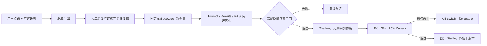

# Prompt 优化与负反馈飞轮

## 1. 原则：线上 Prompt 不自我修改

Prompt 是受版本控制的发布物，不是运行时可写配置。`backend/prompts/customer_v1.md` 与 `customer_v2.md` 由 `PromptRegistry` 按版本和 SHA-256 加载；会话首次路由后冻结版本，消息保存实际版本与哈希。管理员只能调整灰度百分比或回滚，不能让一条用户输入直接改写全局 Prompt。

这条边界同时解决提示词注入、不可复现和“优化后无法解释”的问题。Provider 差异由 `build_messages()` 适配为统一 role/task/context/output 结构，业务规则不散落到供应商 SDK。

## 2. 负反馈闭环

使用 `python scripts/export_feedback_dataset.py --output <受控目录>/negative.jsonl` 导出。导出会遮罩常见邮箱、手机号、证件号、长编号和凭据，并携带回答时的 LLM、Embedding、向量集合、Prompt、RAG、服务与实验版本。每条样本默认：

- `review.status=pending`；
- `eligible_for_optimization=false`；
- 没有自动生成的“标准答案”。

审核员必须先区分 `retrieval_miss / wrong_source / stale_document / generation_unfaithful / citation_error / policy_refusal / user_expectation`，判断证据是否充分，再编写可由证据支持的期望回答。点踩不等于模型错误，不能未经复核直接训练。

## 3. DSPy 的正确使用边界

DSPy 可作为离线候选编译器，不进入在线请求热路径：

1. 冻结语料快照、Embedding/索引版本和数据切分；同一用户/同一问题族不得跨 train/test 泄漏；
2. 优化目标使用多指标硬门，而不是只最大化答案相似度：关键规则召回、拒答准确率、引用支持率、安全违规率、平均 token 与 P95 延迟；
3. 产物渲染为可审阅 Prompt 文件，经过人工、法务/合规和安全评审后进入 Registry；
4. 在 Shadow 中比较答案哈希、引用有效性、耗时和工具调用；副作用工具全部 Mock；
5. 通过灰度控制台逐级放量，任何错误率、Timeout、工具失败率或 TTFT 门限触发自动回滚。

DSPy 不被允许直接写生产 Prompt、不读取未脱敏的全量会话，也不能用测试集反复调参后仍宣称测试结果独立。

## 4. 混合 Prompt 与 Multi-Agent

在线客服链路保持单生成器，以控制 TTFT、成本和错误面；“多 Agent 互相讨论”不默认加入用户请求。更适合的做法是离线分工：

- Retriever Critic：定位漏召回、错产品、错渠道和错时效；
- Grounding Critic：逐结论检查证据是否支持引用；
- Policy Critic：检查隐私、身份边界、承诺和高风险输出；
- Performance Critic：比较 token、TTFT、Rerank 调用率和拒答率。

各 Critic 只输出结构化评分，不暴露或保存推理过程。线上由确定性门控和 Claim Verifier 承担可执行保障：除了引用白名单，还校验数字/单位、产品实体、危险动作极性和原文支持片段，而不是依赖另一个模型“觉得没问题”。

## 5. 晋升门槛

小米演示集的 Stable `text-embedding-v4/512`、Canary `qwen3.7-text-embedding/512` 与 Canary+`qwen3-rerank` 当前均通过 30 条困难检索门。它证明检索链路可回归，不等于目标 LLM 的答案质量或真实生产充分性。

生产晋升至少要求：真实点踩样本和高频问法分层抽样；关键规则召回 ≥95%；无知识拒答准确率 ≥98%；引用支持率 ≥95%；安全违规为 0；Canary 错误率、TTFT、成本和人工接管率不劣于事先批准的门限。所有结果必须绑定语料快照与四个独立版本轴，避免把 Embedding 改善误记为 Prompt 改善。
