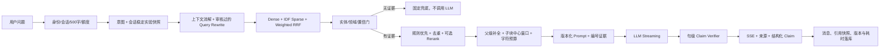

# Question.md 评审导读与设计闭环

本文不是新增需求，而是面向 `Question.md` 的评审入口。它把题目评分点、设计理由、代码落点、运行证据和明确边界连接起来，避免“代码实现了但提交文档无法解释”。详细接口、表结构和流程仍以题目指定的四份文档为准。

## 1. 建议评审顺序

1. 运行：首次配置 `.env` 后，在根目录执行一条 `docker compose up --build -d`，再按 `运行指南.md` 分别打开 `/user` 与 `/admin`；Alembic、管理员和三篇资料向量化都在启动链内完成。
2. 整体取舍：根目录 `项目说明.md`。
3. 40% AI 链路与 25% AI 工程思维：`docs/AI架构设计.md`。
4. REST/SSE 契约：`docs/API文档.md`。
5. ER 图、约束与一致性：`docs/数据库设计.md`。
6. 正常链路和失败恢复：`docs/业务流程说明.md`。
7. 逐条核对：`docs/需求追踪矩阵.md`。

## 2. 核心设计主张

系统不是“把 Top-K 文本交给模型”的演示，而是一条带不变量的证据链：



需要始终成立的约束：

- 未通过门控的片段不能进入 Prompt；空检索不能让模型凭常识补答案。
- 画像、历史、任务和文档都是不可信数据，不能覆盖 System Prompt，也不能证明业务事实或授权。
- 每个会话固定模型、Embedding/collection、Prompt、RAG 和服务版本，多轮中途不能漂移。
- 用户看到的来源来自本轮实际 Prompt 证据；最终 `claims` 还给出引用 ID 和精确 `supporting_spans`。
- Stable 与 Canary Embedding 不共享 collection；模型、维度、索引名作为一个原子版本使用。

## 3. RAG 算法为何这样设计

### 3.1 入库：小块负责找准，父块负责答全

TXT/MD/PDF/图片先形成标题或页级父块，再在父块内切约 900 字子块并保留 120 字 overlap。子块向量化时拼入文档名和章节名，payload 仍保存原文、父文、章节路径和子块在父文中的偏移。这样同一句“七日内”位于不同产品章节时，标题也参与语义区分；命中后又能恢复条件、例外和上下文。

索引 schema 为 4。Qdrant 使用命名向量：`dense` 保存语义向量，`lexical` 保存稀疏词项并启用 collection 级 IDF。新增文档只 upsert 自己的 point，不重建其他文档；删除按 `document_id` 同步清理两套 collection。

### 3.2 查询：Stable 与 Canary 是不同算法，不只是不同名字

| 策略 | 查询 | 召回 | 候选/最终 | Rerank | 上下文 |
|---|---|---|---|---|---|
| Stable `hybrid_rrf_v2` | 原问题 + 确定性口语改写形成单语义查询 | Dense + Sparse，Top-12 | 10 / 6 | 条件触发，融合权重 0.55 | 12000 字符 |
| Canary `multi_rrf_v3` | 原问题和最多 2 条审核过的同义扩展分别 Embedding | 多 Dense + Sparse，Top-20 | 20 / 6 | Canary 配置为 always，融合权重 0.70 | 12000 字符 |

所有通道在一次 Qdrant `query_batch_points` 往返中完成。融合不是把不同量纲的 cosine 与关键词分数直接相加，而是 Weighted Reciprocal Rank Fusion：

```text
score(document) = Σ channel_weight / (rrf_k + rank_in_channel)
rrf_k = 60
原问题 dense 权重 = 1.0
sparse 权重 = 1.0
全部扩展查询共享总权重 = 0.75
```

扩展总权重按扩展数量均分，防止“多生成几个 query 就天然得分更高”。Query Rewrite 只使用代码审阅过的客服别名，例如“电池变胖 → 电池鼓包”，不额外调用 LLM，因此没有改写幻觉和额外 TTFT。

### 3.3 门控与重排：相关性排序不能替代业务边界

Weighted RRF 后还要经过产品、业务和领域实体一致性门、最大 dense distance 0.68 或最小 lexical score 0.08、关键规则保护和近重复抑制。语义相近但产品不同的片段不能只靠 Reranker 侥幸排后，而应在进入 Prompt 前剔除。

Rerank 只看有界候选，服务有独立超时、舱壁和熔断；失败保留确定性顺序。真实 30 例消融中，Canary `qwen3-rerank` 将 Fusion MRR 从 0.98 提高到 1.0、Precision 从 0.4540 提高到 0.7067，但远程 Rerank P95 约 4.84 秒。因此生产策略是条件触发或先走 Canary，而不是为了准确率数字直接全量开启。

### 3.4 上下文：关键子块不会因父块截断而消失

最终证据最多 6 条。若父块超过剩余预算，系统根据 `child_start/child_end` 在命中子块周围截取窗口，而不是永远取父块开头；这解决了答案位于长章节末尾时“召回正确、Prompt 却丢答案”的问题。历史另受最近 6 轮和 6000 字符预算约束，知识证据与历史预算互不挤占。

## 4. 三类题目重点问题的闭环

| 问题 | 运行决策 | 为什么 | 验证 |
|---|---|---|---|
| 检索为空 | `sources=[]`，固定兜底，不调用 LLM | 从根源消除无上下文幻觉并节约调用 | 空库、未知汽车费用、品牌近邻反例 |
| 检索依赖故障 | 返回类型化 `RETRIEVAL_UNAVAILABLE`，不能伪装成“知识库没写” | 业务无答案与基础设施故障需要不同恢复动作 | 故障注入与 SSE error 测试 |
| 上下文超长 | 子块召回、父级去重/补全、规则优先、Top-6、中心窗口和硬预算 | 不依赖模型在长文本中自行找重点 | 父块尾部、复合问题、关键规则用例 |
| LLM 幻觉 | 不可信边界、逐事实引用、句级缓冲、Claim Verifier、抽取式降级 | “引用编号存在”不等于引用支持结论 | 错数字、未知引用、危险动作极性测试 |
| 提示词注入 | 输入侧明显攻击提前拒绝；证据侧指令不执行 | 文档和用户文本都不应拥有系统权限 | 泄露提示词、伪造引用反例 |
| LLM 超时/限流 | Stable/Canary 分池舱壁与熔断；安全证据摘录 | 保持可用但不输出未经证实的生成内容 | resilience、fallback、capacity 测试 |

Claim Verifier 对每个带引用事实段执行四类快速校验：引用白名单、数字/单位一致、产品实体一致、危险动作正反极性，并要求引用原文存在足够词项支持。未通过的句段不发送；回答不足时追加逐句引用的原文摘录。它是确定性在线守门，不冒充完整 NLI，目标 LLM 上线仍需人工标注 Faithfulness 和 Citation Precision。

## 5. 记忆、画像和人工的职责边界

- 短期记忆：同 Session 最近 6 轮，只用于理解省略式追问。
- 长期记忆：用户单独同意后保存有界抽取摘要；撤回即删除摘要。
- 用户画像：偏好与事实分开。事实记录类型、来源、置信度、确认时间、有效期和撤销状态；只允许设备型号、购买渠道、联系渠道、服务地区等低风险字段，拒绝密码、验证码、证件、银行卡、Key、邮箱和完整手机号。
- 画像参与检索时只能补充用户本轮未明确的型号/渠道，不能覆盖本轮明确条件。
- 任务记忆：有类型的浅层 slots，使用 version 乐观锁；“用户想退款”不等于“退款已批准”。
- 人工接管：用户确认后幂等建单，管理员按状态机和 version 认领/结案；系统不虚构坐席在线或业务已执行。

## 6. 灰度、vLLM 和分布式落地

所有模型请求都经过 API Gateway/Experiment Router，前端不能直连 vLLM。模型、Embedding、Prompt、RAG 和推理服务分别记录版本；路由支持租户、用户、Conversation 白黑名单、Intent 强制 Stable 和 HMAC 稳定桶。Shadow 结果不返回用户、不写记忆，副作用工具必须 Mock；错误率、Timeout、工具失败率或 TTFT 超门后执行 Kill Switch。

推理依赖按 `能力 + stable/canary pool + endpoint/model target` 隔离舱壁和熔断，Canary 满载或熔断不影响 Stable。生产部署前还必须由平台提供并验证 model × service 能力矩阵；只有目标服务确实加载了目标模型，独立灰度组合才可放量。示例 vLLM 清单是硬件相关模板，不把未在目标 GPU 实测的镜像、并行度和 KV Cache 参数伪装成通用答案。

文档入库的分布式 worker 使用 MySQL 租约、`SKIP LOCKED`、attempt fencing 和文档级 advisory lock。初次入库必须两套索引都成功才发布 READY；READY 文档补 Canary 时失败不会删除健康的 Stable 索引。MySQL 是业务可见性的权威，查询还会二次过滤文档 READY 状态。

## 7. 评分项到证据

| `Question.md` 评分项 | 本项目证据 |
|---|---|
| AI 链路完整性 40% | 上传解析、双 Embedding、Qdrant Hybrid、Rerank、Prompt、LLM POST-SSE、来源卡、引用快照均为真实链路 |
| AI 工程思维 25% | 空检索不调用模型、上下文中心窗口、规则优先、Claim Verifier、熔断降级、30 例分层评测 |
| 代码质量 20% | AI 模块显式实现、类型化状态、故障补偿、99 项测试、82.23% 覆盖率、Ruff 和前端构建通过 |
| 数据库与 API 15% | MySQL/Alembic `0012`、约束与乐观锁、完整 REST、POST-SSE 终止不变量、OpenAPI/Pydantic 校验 |

评测报告位于 `backend/evaluation`，分别保存 Stable、Canary、Canary+Rerank 的配置指纹、策略 SHA、语料/用例 SHA、逐例结果和阶段延迟。报告明确 `generation_invoked=false`：它证明检索链路，不冒充目标模型的答案级质量。

## 8. 明确边界

- 当前多模态用于知识入库，不支持聊天消息直接附图。
- 本地 Qdrant 适合验收，生产副本、快照、故障域和恢复演练由目标平台落实。
- 在线 Claim Verifier 是高收益规则守门，不替代完整 NLI/人工审查。
- 五轴灰度的代码路由已具备，但任意 model/service 组合必须先通过部署能力矩阵。
- KMS/Vault、WORM/SIEM、法定留存、DPA 与数据主体流程属于生产制度门，不以应用代码“宣称合规”。

这些边界是提交可信度的一部分：已完成项给出代码和测试，平台或制度责任明确写出，不把设计稿描述成已运行能力。
