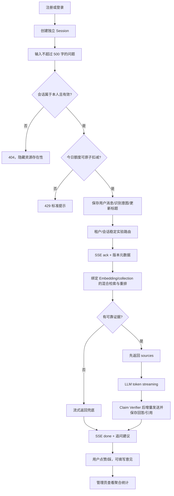
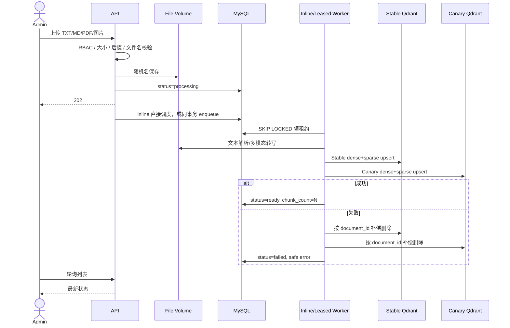

# 业务流程说明

## 1. 用户问答完整链路



扣额度发生在用户消息保存前；超长、无权会话和非法知识库会在扣额度前拒绝。进入有效问答后，即使最终供应商失败也视为一次请求，防止通过反复断开制造无限外部调用。

## 2. 多轮上下文

每个 Session 独立。新问题读取同一 Session 最近 6 轮（最多 12 条 user/assistant 消息）；用户显式同意后，更早消息以有界抽取式摘要补充。画像和最多 5 个 active 任务可调整语气/连续状态，但都不是事实来源。旧回答必须在本轮重新检索 evidence，不能自我引用。

## 3. 文档上传与可见性



初次入库只有两套 vector upsert 都成功后才标记 `ready`。若 Stable 成功、Canary 失败，只清理本次成功写入的 Stable；若对既有 READY 文档补建缺失的 Canary，失败只保留重试状态，绝不能删除原先健康的 Stable。处理中的向量存在极短暂写入窗口；查询还会以 MySQL READY 状态二次过滤。对要求可证明原子切换的超大规模环境，可进一步增加 collection generation/active manifest 和 outbox worker，查询只接受已提交 generation；这是明确的跨系统一致性演进点。

## 4. 文档删除

1. 检查管理员权限和文档存在性。
2. 状态改为 `deleting`，阻止界面重复操作。
3. Stable/Canary Qdrant 均按 `document_id` payload filter 删除全部向量；任一失败则保留元数据并改为 `delete_failed`，返回 503。
4. 删除 MySQL 文档元数据；历史 citations 的 FK 自动置空，快照保留。
5. 删除上传原文件；若文件系统清理失败记录告警，后续 orphan 清理任务可重试。

删除不会重建其他文档索引，因此支持增量管理。

## 5. 权限与数据流

```mermaid
flowchart LR
  Guest -->|register/login| Auth
  UserPortal[/user 用户入口] -->|普通账号| User
  AdminPortal[/admin 管理入口] -->|管理员账号| Admin
  User -->|仅自己的 user_id| Sessions
  User -->|仅自己的 assistant message| Feedback
  Admin --> Sessions
  Admin --> Knowledge[知识库管理]
  Admin --> Metrics[全局聚合统计]
  Backend --> Router[Experiment / Model Router]
  Router --> LLM[Stable/Canary LLM 与 Embedding]
  Browser -.禁止直连.-> LLM
```

两个入口分别保存普通用户与管理员 Token，便于同一浏览器双角色验收；入口和菜单只改善体验，不作为授权边界。后端仍在每次请求中校验 Token、查询数据库角色，并对资源执行 user_id 归属过滤。

管理员可通过专用审计接口读取全量会话用于客服质量与争议处理；每次列表/详情读取都会写入 `admin_data_access_audits`，不走普通用户接口。生产还必须将审计外送 SIEM/WORM、要求临时授权和访问原因，并按数据分类遮罩高敏字段；普通数据库表不能冒充不可篡改日志。

## 6. 失败恢复清单

| 故障 | 用户表现 | 数据处理 | 恢复 |
|---|---|---|---|
| MySQL 不可用 | ready 503 / 请求失败 | 不调用模型 | 恢复 DB 后重试 |
| 文档解析失败 | 文档 failed | 原文件和失败元数据保留，vectors 清理 | 修复配置/文档后点击重试 |
| Embedding 限流 | 文档 failed | 补偿删除本次 vectors | 重试入库 |
| 检索失败 | SSE error | 用户消息已留存，无伪答案 | 依赖恢复后重新提问 |
| LLM 建流失败 | 带引用的安全摘录 | 保存 generation_fallback | 熔断恢复后自动正常调用 |
| LLM 生成错误数字/反向安全动作 | 错误句不发送，必要时补证据原句 | 增加 filtered 计数并保存校验后的 Claim | 进入点踩/抽查集后调 Prompt、检索或模型 |
| SSE 中途断开 | 页面停止 | 保存已有 partial 为 interrupted | 历史可见，重新提问 |
| 删除 vector 失败 | 503 | 文档元数据保留为 delete_failed | 管理员再次删除 |
