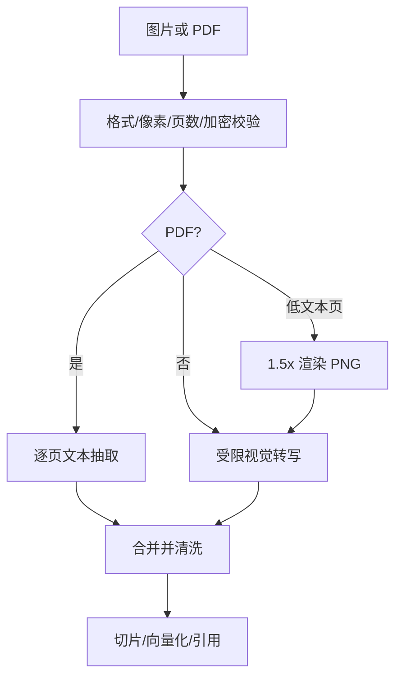
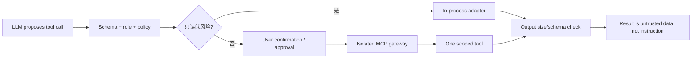

# 多模态理解与工具沙盒

## 1. 当前多模态范围

多模态用于知识入库理解，而不是让浏览器直接把图片发给模型。管理员可上传 PNG/JPEG/WebP；PDF 先提取每页文本，对低文本页最多渲染 `MAX_PDF_VISION_PAGES` 页并调用视觉模型转写。转写结果再进入与文本完全相同的切片、embedding、Qdrant、置信门和引用链路，因此图片答案仍可追溯到原文档。



安全边界：

- Pillow 解码并 `verify()`，只接受真实 PNG/JPEG/WebP，限制总像素，防止仅信任扩展名和解压炸弹式资源消耗；
- PDF 拒绝加密文件与超过 1000 页的文件，视觉页数另有硬上限；
- 视觉 System Prompt 只允许转写可见文字和客观描述，图片中的指令一律当数据；看不清必须声明，不能猜；
- `MULTIMODAL_PROVIDER=disabled` 时图片/纯扫描 PDF 明确失败并可重试，不制造空知识；
- base64 只在后端到受控模型端点传输，不进入前端、数据库或日志。

这不是恶意文件的完整 CDR/杀毒沙箱。面向不可信互联网上传时，还应在独立低权限容器中做 AV/CDR、CPU/内存/文件句柄限制、无网络解析和对象存储隔离，再把净化后的对象交给 worker。

## 2. vLLM 接入

配置示例：

```dotenv
LLM_PROVIDER=openai_compatible
LLM_BASE_URL=http://vllm:8000/v1
LLM_MODEL=Qwen/Qwen2.5-VL-7B-Instruct
MULTIMODAL_PROVIDER=openai_compatible
VISION_MODEL=Qwen/Qwen2.5-VL-7B-Instruct
```

模型是否支持指定 MIME、上下文长度和多图上限必须以部署版本的 vLLM 与模型卡实测。`deploy/k8s/vllm-example.yaml` 给出 tensor parallel 参考，但不自动上线。视觉转写失败会走入库队列重试，不影响在线文本问答。

## 3. 工具与 MCP 的两层边界

`ToolSandbox` 是应用策略层，不声称它等于 OS 沙箱。它只适合无副作用、可信实现的纯工具，并提供：

- 显式 allowlist，禁止 shell 与动态 import；
- 每工具角色、输入 validator、输入/输出 JSON 字节上限；
- timeout 与全局并发 semaphore；
- call_id、工具名、user_id、耗时、状态、输入哈希审计，不记录原始敏感参数。

高风险或副作用 MCP server 必须放在独立进程/容器：非 root、只读根文件系统、临时文件配额、seccomp/AppArmor、默认拒绝网络、按域名/方法 egress allowlist、短期工作负载身份、每调用幂等键与业务授权。应用在调用前仍要经过 ToolSandbox 等价的契约层；容器隔离不能替代“这个用户是否可以退款”的业务判断。

推荐调用流程：



当前客服主链路没有注册任何会修改真实业务的工具，因此模型不能声称已退款、改订单或通知人员。`ToolSandbox` 已通过 allowlist 与角色测试，但外部 MCP gateway 是明确的集成边界，不在本次项目中伪造实现。
