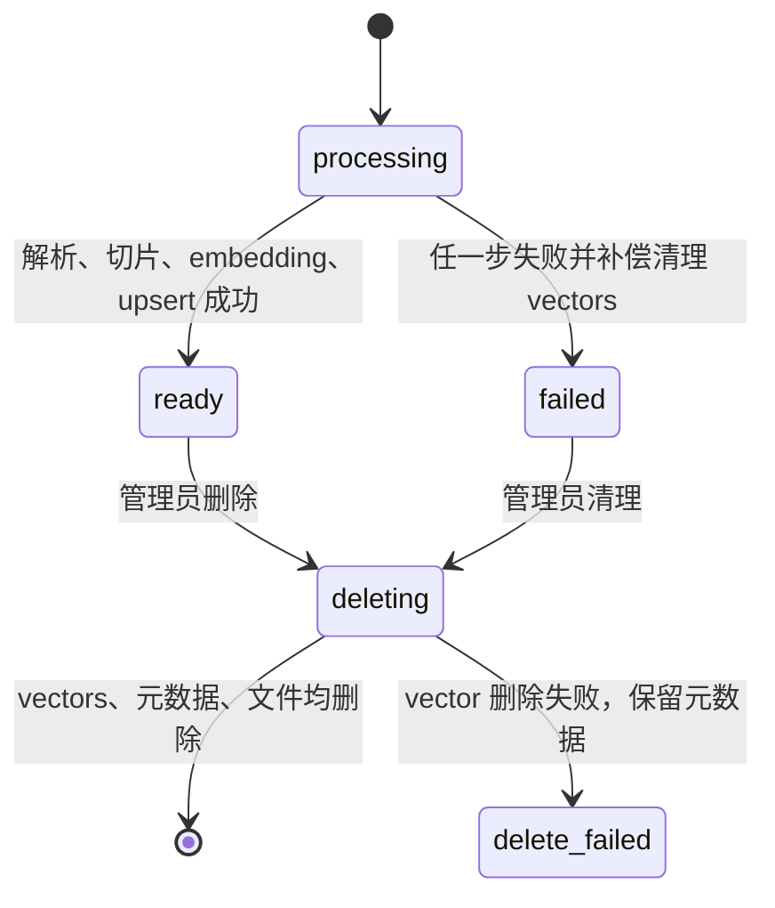

# 数据库设计

## 1. 存储边界

MySQL 保存强一致业务元数据：租户用户、会话、消息、引用快照、反馈、知识库文档状态、每日额度、登录失败桶、实验控制与审计。Qdrant 的 Stable/Canary collection 分别保存命名 dense/lexical 向量、原始 chunk 和检索 payload。上传原文件保存于受控目录/volume，数据库只存随机路径。管理员控制台保存的 API Key 使用 Fernet 加密，API 永不回显明文，只显示带服务端密钥的 HMAC 指纹；生产主密钥必须来自 KMS/Vault。

## 2. ER 图

```mermaid
erDiagram
    USERS ||--o{ CONVERSATION_SESSIONS : owns
    USERS ||--o{ DAILY_USAGE : consumes
    USERS ||--o{ FEEDBACK : submits
    USERS ||--o{ KNOWLEDGE_DOCUMENTS : uploads
    USERS ||--o| USER_PROFILES : configures
    USERS ||--o{ USER_PROFILE_FACTS : owns
    USERS ||--o{ CONVERSATION_TASKS : owns
    USERS ||--o{ HANDOFF_TICKETS : requests
    CONVERSATION_SESSIONS ||--o{ MESSAGES : contains
    CONVERSATION_SESSIONS ||--o| SESSION_MEMORIES : compacts
    CONVERSATION_SESSIONS ||--o{ CONVERSATION_TASKS : tracks
    CONVERSATION_SESSIONS ||--o{ HANDOFF_TICKETS : escalates
    MESSAGES ||--o{ MESSAGE_CITATIONS : cites
    MESSAGES o|--o{ USER_PROFILE_FACTS : learned_from
    MESSAGES ||--o| FEEDBACK : receives
    KNOWLEDGE_BASES ||--o{ KNOWLEDGE_DOCUMENTS : contains
    KNOWLEDGE_DOCUMENTS ||--o| KNOWLEDGE_INGESTION_JOBS : ingests
    KNOWLEDGE_DOCUMENTS o|--o{ MESSAGE_CITATIONS : source_snapshot
    USERS ||--o{ ADMIN_DATA_ACCESS_AUDITS : performs
    USERS ||--o{ EXPERIMENT_CONTROL_AUDITS : changes
    USERS ||--o{ PROVIDER_CREDENTIAL_AUDITS : changes
    EXPERIMENT_CONTROLS ||--o{ EXPERIMENT_CONTROL_AUDITS : snapshots
    PROVIDER_CREDENTIALS ||--o{ PROVIDER_CREDENTIAL_AUDITS : records

    LOGIN_THROTTLES {
      char64 key_hash PK
      int failures
      datetime window_started_at
      datetime locked_until
      datetime updated_at
    }

    USERS {
      char36 id PK
      varchar tenant_id
      varchar email UK
      varchar phone UK
      varchar password_hash
      enum role
      boolean is_active
    }
    CONVERSATION_SESSIONS {
      char36 id PK
      char36 user_id FK
      varchar title
      enum status
      char36 turn_lock_token
      datetime turn_lock_expires_at
      datetime updated_at
    }
    MESSAGES {
      char36 id PK
      char36 session_id FK
      enum role
      longtext content
      varchar intent
      varchar retrieval_status
      int latency_ms
      varchar embedding_version
      varchar vector_index_version
    }
    MESSAGE_CITATIONS {
      char36 id PK
      char36 message_id FK
      char36 document_id FK_NULLABLE
      varchar chunk_id
      varchar source_name
      varchar excerpt
      int score
    }
    KNOWLEDGE_BASES {
      char36 id PK
      varchar name UK
      boolean is_active
    }
    KNOWLEDGE_DOCUMENTS {
      char36 id PK
      char36 knowledge_base_id FK
      varchar original_name
      char64 sha256
      enum status
      int chunk_count
    }
    FEEDBACK {
      char36 id PK
      char36 message_id FK_UK
      char36 user_id FK
      tinyint rating
      varchar comment
    }
    DAILY_USAGE {
      char36 id PK
      char36 user_id FK_UK
      date usage_date UK
      int question_count
    }
    USER_PROFILES {
      char36 user_id PK_FK
      varchar preferred_name
      enum response_style
      boolean memory_consent
      varchar consent_version
      boolean profile_learning_consent
      varchar profile_consent_version
    }
    USER_PROFILE_FACTS {
      char36 id PK
      char36 user_id FK
      varchar fact_type
      varchar normalized_value
      enum source
      char36 source_message_id FK_NULLABLE
      int confidence
      datetime expires_at
      datetime revoked_at
    }
    SESSION_MEMORIES {
      char36 session_id PK_FK
      text summary
      int compacted_message_count
    }
    CONVERSATION_TASKS {
      char36 id PK
      char36 session_id FK
      json slots
      int version
      enum status
    }
    HANDOFF_TICKETS {
      char36 id PK
      char36 session_id FK
      enum trigger
      enum status
      int priority
    }
    KNOWLEDGE_INGESTION_JOBS {
      char36 id PK
      char36 document_id FK_UK
      enum status
      int attempts
      datetime lease_expires_at
    }
    EXPERIMENT_CONTROLS {
      varchar id PK
      boolean canary_enabled
      int stage
      int model_canary_percent
      int embedding_canary_percent
      int prompt_canary_percent
      int rag_canary_percent
      int service_canary_percent
      int shadow_canary_percent
      int version
    }
    EXPERIMENT_CONTROL_AUDITS {
      char36 id PK
      char36 admin_id FK_NULLABLE
      int from_version
      int to_version
      json previous_config
      json next_config
      varchar reason
    }
    CANARY_OBSERVATIONS {
      char36 id PK
      varchar experiment_group
      varchar model_version
      varchar embedding_version
      varchar prompt_version
      varchar rag_version
      varchar service_version
      boolean success
      boolean timed_out
      boolean tool_failed
      int ttft_ms
    }
    SHADOW_OBSERVATIONS {
      char36 id PK
      char36 stable_message_id
      varchar model_version
      varchar embedding_version
      varchar prompt_version
      varchar rag_version
      varchar service_version
      char64 stable_answer_sha256
      char64 canary_answer_sha256
      boolean citation_valid
      boolean side_effects_mocked
    }
    PROVIDER_CREDENTIALS {
      varchar id PK
      varchar category
      varchar provider
      varchar base_url
      varchar model
      text api_key_ciphertext
      char16 api_key_fingerprint
      boolean enabled
      varchar validation_status
      int version
    }
    PROVIDER_CREDENTIAL_AUDITS {
      char36 id PK
      varchar credential_id
      char36 admin_id FK_NULLABLE
      int from_version
      int to_version
      json changed_fields
      boolean succeeded
      varchar error_code
    }
    ADMIN_DATA_ACCESS_AUDITS {
      char36 id PK
      char36 admin_id FK
      varchar action
      varchar target_id
      varchar request_id
      varchar purpose
    }
```

## 3. 表与关键约束

### `users`

`email`、`phone` 分别唯一且至少有一个非空。应用层要求恰好提供一个，以简化账号语义。`tenant_id` 默认 `default`，由企业身份接入层或受控管理流程分配，不接受公开注册任意指定租户；它用于稳定灰度分桶与未来租户级策略。密码只存 Argon2 encoded hash。`role` 为 `user/admin`，所有管理接口二次校验数据库中的当前角色，不信任 JWT 内角色字段做最终授权。

### `login_throttles`

登录失败按标准化账号的 `HMAC-SHA256` 主键累计，不保存邮箱、手机号或可直接反查的裸 SHA。达到默认 5 次后锁定 15 分钟，`Retry-After` 告知客户端等待时间；不存在账号也执行相同 Argon2 哨兵校验和限流，避免账号枚举与明显时序差。该表没有用户外键，因为不存在账号同样需要保护；`updated_at` 索引支持抽样清理过期桶。此应用层账号维度控制跨 API Pod 一致，生产仍需在可信入口叠加 IP/设备维度限流。

### `conversation_sessions` / `messages`

会话按 `user_id, updated_at` 建联合索引；查询详情必须同时带当前 `user_id`，因此猜到 UUID 也不能越权。会话保存首次用户可见实验决策：模型池、Embedding 模型/维数/物理索引、Prompt 哈希、RAG 和服务版本，保证多轮不漂移。消息只允许 user/assistant 两种业务角色，System Prompt 不进入历史数据库；回答消息保存实际生效版本、request ID、TTFT、tokens、tool calls、finish reason 和 fallback。`retrieval_status` 区分 `empty/matched/grounded_filtered/generation_fallback/generation_partial/interrupted`。

### 实验、Provider 与数据访问审计

`experiment_controls` 是全局灰度控制行，使用 `version` 乐观锁；五个独立灰度百分比和 Shadow 百分比的每次变更在 `experiment_control_audits` 保存前后快照、操作者和原因。`canary_observations` 保存回滚窗口所需的版本、错误、Timeout、工具失败和 TTFT；`shadow_observations` 只保存答案哈希与比较指标，不保存第二份回答原文，且 `side_effects_mocked=true`。

`provider_credentials` 保存加密密钥、URL、模型、启停和验证状态；`provider_credential_audits` 不保存密钥或前后配置明文。`admin_data_access_audits` 对管理员读取会话列表/详情做只追加记录；应用没有修改/删除接口。数据库管理员仍可篡改普通表，生产需外送 SIEM/WORM 才能满足更强不可篡改要求。

### `knowledge_documents`

`status` 是可观测状态机：



同一知识库中，`(knowledge_base_id, sha256)` 有数据库唯一约束。应用先查询以返回友好 409，数据库约束再封堵多 API Pod 同时上传的竞态；失败文档保留原记录并通过 retry 状态机重试，不通过重复上传制造两份元数据。

### `message_citations`

引用不是临时前端字段，而是回答时证据的审计快照。`source_name/excerpt/score/display_order` 永久保留；`document_id` 在源文档删除时 `SET NULL`。这样既满足知识删除，又不会破坏历史回答的可解释性。若监管要求彻底遗忘内容，应增加专门的引用摘要擦除流程，而不是误以为删向量已经删除全部副本。

### `daily_usage`

`(user_id, usage_date)` 唯一。扣额度使用带 `question_count < limit` 条件的原子 UPDATE；无记录时 INSERT，遇到并发唯一键竞争再重试 UPDATE。避免“先 SELECT 数量、两个请求同时通过”的竞态。

### `feedback`

`message_id` 唯一，保证每个回答每个所有者只有一个当前反馈；更新为幂等 PUT。数据库 CHECK 约束 rating 只能为 -1 或 1，API 同时校验。

### 画像、长期记忆与任务

`user_profiles` 是每用户一行的显式偏好和两类独立 consent：长期摘要 consent 与画像学习 consent 不能互相替代。`user_profile_facts` 保存低风险客服事实，`(user_id, fact_type, normalized_value)` 唯一；`source` 区分 explicit/conversation/CRM，`source_message_id` 删除后置空，`confidence` 由 CHECK 限制在 0—10000，`expires_at/revoked_at` 决定是否参与画像和检索。显式确认事实为 10000 且不自动过期；会话事实带 TTL，关闭画像学习时软撤销，保留最小审计轨迹但不再使用。

`session_memories` 只在长期记忆 consent 有效时存在，以 session 为边界，撤回后删除。`conversation_tasks` 用 JSON 保存有界 slots，`version` 作为乐观锁；条件 UPDATE 不命中就返回 409，防止并发处理丢失状态。画像、摘要和任务均不是知识证据或业务授权。

### 人工工单与入库任务

`conversation_sessions.turn_lock_token/turn_lock_expires_at` 是单轮回答的跨 Pod 租约：同一 Session 同时只允许一个生成链路，SSE 心跳续租，进程消失后可过期接管；删除会话也用同一条件原子避让活跃回答。`handoff_tickets` 对 status/priority/created_at 建队列索引，priority 由 CHECK 限制在 1—5。MySQL 无部分唯一索引，因此 nullable `active_dedupe_key` 只在 open/in_progress 时等于 session_id，数据库唯一约束能在多 API Pod 并发建单时保证一个活跃工单；结单后置 NULL 允许新一轮。`version >= 1` 是管理员处置的乐观锁，状态迁移、处理人、结论与 active key 在一次条件 UPDATE 中提交，旧版本写入返回 409。`knowledge_ingestion_jobs.document_id` 唯一，状态为 queued/running/retry/completed/dead；租约 owner + attempt 是围栏令牌，worker 周期续租，过期 worker 不能覆盖新尝试，最终尝试过期会收敛为 dead/failed。

## 4. Qdrant payload

Stable 与 Canary 使用不同 collection；每个 collection 同时含 cosine `dense` 与启用 Qdrant collection IDF 的 BM25-style `lexical` 两个命名向量。Point ID 由 `document_uuid + chunk_index` 确定性生成，每条记录包含：

```json
{
  "document_id":"...",
  "knowledge_base_id":"...",
  "source_name":"退款政策.txt",
  "chunk_index":0,
  "summary":"客户在首次购买……",
  "priority":2,
  "parent_id":"P0",
  "parent_content":"完整章节正文",
  "section_path":"售后/退换",
  "child_start":120,
  "child_end":380,
  "schema_version":4
}
```

按指定知识库问答时用 `knowledge_base_id` payload filter；删除文档在所有已配置集合按 `document_id` filter 批量删除。Embedding 维数在 collection 创建时固定，更换模型必须新建 collection、双写/回灌、评测后再提升百分比，不能用新模型查询旧向量。

## 5. 初始化与迁移

Alembic `20260720_0001` 是可重放初始结构；`0002—0005` 增加 turn lease、去重、分布式登录限流、工单锁和受管种子；`20260723_0006—0009` 增加请求/版本观测、自动回滚、加密 Provider 和双 Embedding 索引绑定；`0010` 增加租户实验路由；`0011` 增加管理员数据读取审计；`0012` 增加用户画像学习同意、事实来源、置信度、有效期与软撤销。最新 head 为 `20260723_0012`。容器首启执行 `alembic upgrade head`；生产 `AUTO_CREATE_TABLES=true` 会拒绝启动，Kubernetes 由独立 migration Job 放量前执行。`backend/database/init.sql` 仅是 MySQL 人工审阅快照，不是升级机制。所有服务统一用 UTC 写时间，日额度按 `BUSINESS_TIMEZONE` 得出业务日期。
