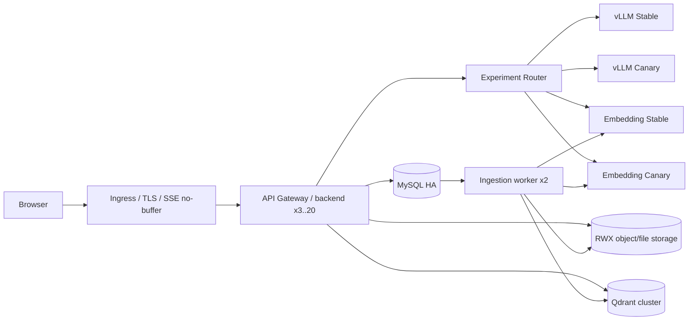

# 生产架构、容量治理与灰度发布

## 1. 目标拓扑

本项目把本地可复现与生产高可用明确分开。`docker-compose.yml` 是单机验收基线；`docker-compose.distributed.yml` 演示 API/worker/Qdrant 进程拆分；`deploy/k8s` 是生产参考清单。MySQL 与 Qdrant 在生产清单中只配置外部集群端点，不用单副本 StatefulSet 冒充高可用。



API 无本地会话状态，JWT、会话、额度和单轮 turn lease 均落 MySQL，因此不依赖 sticky session。同一 Session 的并发请求通过带 TTL 的条件 UPDATE 只允许一个进入，SSE 事件/心跳续租，异常与断连按 token 释放。SSE 只在单条连接生命周期内占用一个 Pod；Pod 终止前先从 Service 摘除并等待 15 秒，`terminationGracePeriodSeconds=75` 给在途流留出结束窗口。客户端仍应把中断视作可恢复事件，而不是假设长连接绝不掉线。

## 2. 数据与任务一致性

### 数据库迁移

生产设置强制 `AUTO_CREATE_TABLES=false`。发布顺序是：

1. 备份并在影子库执行 `alembic upgrade head` 与 `alembic check`；
2. 单独运行 `migration-job.yaml`，等待成功；
3. 部署只使用旧字段与新字段兼容的应用镜像；
4. 灰度稳定后才能在后续版本清理旧字段。

迁移 Job 故意不在 `kustomization.yaml` 中，避免每次声明式同步反复创建有副作用的 Job。Job 名带 revision，必须由发布流水线显式执行和等待。初始完整 revision 位于 `backend/migrations/versions`；`backend/database/init.sql` 仅为审阅快照，Alembic 是唯一升级入口。

### 入库队列

`INGESTION_MODE=queue` 时，上传文件和任务记录在同一 MySQL 事务提交。worker 用 `SELECT ... FOR UPDATE SKIP LOCKED` 竞争任务，具有：

- 租约与超时回收；
- 处理期间按租期三分之一周期续租；续租失败立即取消失去所有权的协程；
- 最多 5 次指数退避，耗尽后进入 `dead`；
- 最后一次尝试所在进程崩溃且租约过期时，任务与文档自动收敛为 `dead/failed`，不永久卡在 running；
- `attempts + lease_owner` 组成 fencing token，过期 worker 的迟到完成不能覆盖新租约；
- Qdrant 写入以稳定 point ID 幂等执行，失败先补偿删除再重试；
- MySQL 的 `document.status=ready` 是可检索权威状态，即使 Qdrant 暂留脏 point，查询也会二次过滤。

原文件必须是 RWX CSI 卷或对象存储。示例用 RWX PVC；更大规模建议把文件接口替换为带版本与校验和的对象存储，不应让各 Pod 使用独立本地盘。

## 3. Qdrant 与知识库高可用

应用通过 `QDRANT_URL/QDRANT_API_KEY` 连接外部 Qdrant，readiness 同时检查 MySQL 与 collection。生产集群需由平台侧完成多节点、副本、跨故障域、TLS、认证、快照和定期恢复演练；这些能力不能由一个客户端 URL 自动保证。

操作约束：

- collection 维度必须与 embedding 模型一致；换模型新建 collection、全量回灌、离线评测后再切换配置；
- Qdrant server/client 保持同一 minor 系列并固定镜像；跨 minor 升级先查官方迁移路径、做快照和恢复演练，不对持久卷跳版尝试；
- MySQL、上传文件与 Qdrant 快照需记录同一恢复点；
- 文档删除先删向量，再删元数据；向量删除失败进入 `delete_failed`，管理员可以重试，不能静默隐藏；
- 大批量回灌走 worker，不占 API 进程；观察 queued/running/retry/dead 数量与最老任务年龄；
- worker 除 job lease/fencing token 外，还以 MySQL `GET_LOCK` 对同一文档加跨 Pod advisory lock；等待锁时续租，旧 attempt 即使在向量写入后失去租约也不能提交 READY，并会清理自己的过期结果。

## 4. vLLM 与多模态推理池

应用使用统一 OpenAI-compatible Adapter，但所有业务请求必须先经过应用内 Experiment Router，不能让客户端或业务服务直接访问 vLLM。`LLM_BASE_URL/LLM_CANARY_BASE_URL` 指向两个物理隔离的生成 Deployment；`EMBEDDING_BASE_URL/EMBEDDING_CANARY_BASE_URL` 指向两个物理隔离的 pooling Deployment。四套服务拥有独立模型、GPU、镜像 digest、启动参数、日志和伸缩策略，禁止覆盖部署。

Embedding 的模型、输出维度和 Qdrant collection 是原子版本。Stable 与 Canary 可以使用不同维度，因为任何查询只会进入被分配模型对应的物理索引；初次入库会双写两套索引，单边失败不发布 READY；对既有 READY 文档补建 Canary 时，失败不能删除健康 Stable。`vllm-example.yaml` 和 `vllm-embedding-example.yaml` 均未纳入默认 Kustomize：GPU 架构、权重、runner、维数、vLLM 版本与镜像 digest 必须在目标硬件实测后固定。[vLLM 官方 embedding 文档](https://docs.vllm.ai/en/latest/models/pooling_models/embed/)说明 OpenAI-compatible 服务使用 `/v1/embeddings`；不支持维数裁剪的 pooling 模型必须设置 `*_SEND_DIMENSIONS=false` 并使用原生维数建新 collection。

模型版本和 vLLM service 版本虽然是两个实验轴，但“可独立选择”不等于任意组合天然可运行。发布流水线必须维护能力矩阵 `service_version -> loaded model IDs / tokenizer / multimodal capability / max context`，路由配置启用前验证本阶段可能出现的四种 model×service 组合；单模型 Deployment 无法满足交叉组合时，应部署 service×model 物理交叉池，或把两个轴绑定为一个经过验证的实验臂。未通过矩阵的组合保持 0%，不能把上游 `model not found` 当成正常 Canary 错误率再观察。

namespace 默认拒绝 ingress；随附 NetworkPolicy 仅允许 `backend` 与 `ingestion-worker` 访问 `vllm`/`vllm-embedding` 的 8000 端口。若推理池放在其他 namespace，需要用标签化 `namespaceSelector + podSelector` 精确放行，不能为了排障删除默认拒绝策略。

生产建议把聊天、视觉转写和 embedding 分为独立模型池与并发预算：

- API 侧 `LLM_MAX_CONCURRENCY` 是每 Pod bulkhead，等待超时立即降级，避免把外部推理池拖死；
- embedding 侧有独立 timeout、有限重试、bulkhead 与 circuit breaker；查询向量化失败会明确返回检索不可用，不能伪装成空知识或绕过证据让生成模型猜测；
- 连续失败达到阈值后 circuit breaker 打开 30 秒；有可靠证据时返回带引用的抽取式摘要，没有证据仍拒答；
- vLLM 侧按 TTFT、TPOT、running/waiting requests、KV cache 使用率、GPU 显存与 OOM 设告警；
- tensor parallel 解决单模型跨卡，更多副本通过推理网关做负载均衡；模型冷启动期间 readiness 不能放量；
- 不把生成型模型的扩容仅绑定 CPU HPA。GPU 池应基于队列深度/等待时间做定制 autoscaling，并保留暖副本。

## 5. 流量承载与服务降级

### 两级背压

1. ASGI request bulkhead：每 Pod 默认最多 200 个在途请求，包含直到 response body 结束的 SSE；等待 2 秒仍无槽位返回 `503 + Retry-After: 2`。
2. 推理 bulkhead：LLM 默认每 Pod 32 个、embedding 默认 64 个、reranker 默认 8 个并发；注册键为 `capability + stable/canary pool + endpoint/model target`，不仅三种能力互相隔离，Canary 满载/熔断也不会占用 Stable 的槽位或断路器。

`GET /api/v1/health/capacity` 暴露 active/limit/utilization/rejected_total，LLM、embedding、reranker 按 Stable/Canary 分池的 circuit/active/limit/target_count，以及 ingestion queued/running/retry/dead、过期租约数和最老待处理任务年龄；同时保留旧扁平键供已有面板过渡。该端点本身也受 request bulkhead 约束。生产应把同类指标接入 Prometheus，而不是依赖人工轮询该调试端点。

重复 FAQ 的 query embedding 采用每 Pod 有界 TTL 缓存和 single-flight，减少 embedding 池排队；缓存键为 SHA-256，不保存问题明文。它只复用完全相同问题的向量，不缓存召回结果，因此文档增删立即反映在 Qdrant 查询中，不会为了速度返回过期知识。命中率、miss 与合并次数由 capacity 端点观测，低命中业务可将容量设为 0 关闭。

每个依赖熔断器在冷却结束后进入严格半开态，只放行一个探测请求；其余请求快速失败并走既定降级。探测成功才关闭熔断，失败或被取消都会重启冷却窗口；调用代际令牌还会忽略旧慢请求的迟到结果，避免恢复瞬间的 thundering herd、永久占用探针或旧请求误关新熔断。

认证失败由 MySQL HMAC 账号桶在所有 API Pod 间共享，默认 5 次失败锁定 15 分钟；原始邮箱/手机号不进入限流表，不存在账号也走同一校验路径。它解决横向扩容后单机计数可绕过的问题，但不能替代入口网关的 IP/设备限流、验证码策略和异常登录告警。

| 故障/过载 | 行为 | 不允许的行为 |
|---|---|---|
| API Pod 饱和 | 503、Retry-After、上游限流 | 无限排队直到客户端超时 |
| LLM 限流/超时/熔断 | 有证据则返回引用摘录；部分安全流则停止并提示 | 放宽证据门或用常识补答案 |
| Qdrant/DB 不可用 | readiness 失败；检索事件返回明确错误 | 伪装成“知识库没答案” |
| 无可靠召回 | 标准拒答并建议人工 | 调用 LLM 猜测 |
| 多模态不可用 | 图片/扫描 PDF 入库失败且可重试 | 只按文件名或空文本入库 |
| worker 失败 | 租约回收、退避、dead 可观测 | API 请求内无限重试 |

容量脚本 `backend/scripts/load_test.py` 会逐行消费真实 SSE，而不是把响应整体缓冲后伪装成流测试；它分别输出来源就绪 p95、首 token p50/p95/p99、完整响应 p50/p95/p99、RPS、错误率、拒绝数和清理错误。每个虚拟用户结束后删除测试会话，清理失败或超过 `--max-ttft-ms`/`--max-p95-ms`/`--max-error-rate` 都会非零退出。测试账号仍会保留用于配额审计，因此压测必须在隔离环境执行，并分别覆盖稳定负载、阶梯负载、突发、模型慢响应和依赖故障注入。

## 6. 应用级灰度、Shadow 与回滚

Ingress 只负责 TLS、WAF、限流和 API 镜像发布；模型实验由统一 Router 决定，避免一部分入口绕过版本审计。Router 支持五个独立百分比：LLM model、Embedding、Prompt、RAG 和 vLLM service，另有 Shadow 百分比。每个轴使用 HMAC 稳定桶 `tenant_id + conversation_id + axis`，并支持租户、用户、Conversation 白/黑名单和 Intent 强制 Stable；黑名单优先，投诉/售后等高风险 Intent 默认 Stable。

管理员页面提供 Stage0—7、一键 Kill Switch 和不可覆盖的版本更新：

| 阶段 | 流量 | 准入条件 |
|---|---:|---|
| Stage0 | 0% | 固定语料离线 Replay，质量/安全/延迟门通过 |
| Stage1 | Shadow | Stable 返回用户；Canary 结果只比较，不执行副作用 |
| Stage2 | 内部名单 | 员工租户/用户白名单 |
| Stage3—7 | 1%→5%→20%→50%→100% | 每档至少一个业务观察窗，旧版本保留回滚窗口 |

Shadow 会跑 Canary Prompt、RAG、Embedding 独立索引和 vLLM，但不把答案返回用户、不写入对话记忆，退款、短信、订单等工具必须 Mock；当前实现记录答案哈希、引用有效性、词法重合、耗时和所有版本。运行日志与消息审计携带 request/conversation/tenant（通过用户租户）、实验组、model、embedding/index、prompt、rag、service、latency、TTFT、tokens、tool calls、finish reason 和 fallback；原问题不会进入运行日志。

Prometheus 指标覆盖检索/生成/总耗时、TTFT、错误和回退、熔断/舱壁与 Canary 状态；vLLM/GPU 侧由平台采集 ITL/TPOT、tokens/s、GPU、KV cache、waiting/running queue。自动回滚按滚动窗口计算错误率、Timeout、工具失败率和 TTFT P95，达到最小样本后原子关闭 Canary 并记录前后快照。回滚先关闭应用 Canary/Shadow，再处理候选 Deployment；向后兼容迁移不盲目 downgrade。旧 SSE 可在原 Pod 宽限期内结束。

## 7. 部署命令

单机分进程演示：

```powershell
docker compose -f docker-compose.yml -f docker-compose.distributed.yml up --build -d --scale ingestion-worker=2
```

Kubernetes 参考流程：

```bash
# 先替换域名、镜像、外部数据库/Qdrant 地址、RWX StorageClass，并从密钥系统创建 aegis-secrets
kubectl apply -f deploy/k8s/namespace.yaml
kubectl apply -f deploy/k8s/secret.example.yaml
kubectl apply -f deploy/k8s/migration-job.yaml
kubectl -n aegis wait --for=condition=complete job/aegis-migrate-20260723-0012 --timeout=300s
kubectl apply -k deploy/k8s
kubectl -n aegis rollout status deployment/backend
# 稳定版验收后，先部署两套 vLLM/Embedding，再替换 API canary 镜像
kubectl apply -f deploy/k8s/vllm-example.yaml
kubectl apply -f deploy/k8s/vllm-embedding-example.yaml
kubectl apply -k deploy/k8s/canary
```

模板含明确的 `replace-*` 值，未替换前不是生产可执行配置，这是有意的 fail-closed 行为。Canary 不在默认 Kustomize 中，避免平台首次同步就把未验证镜像分流；它只能在稳定版和数据迁移就绪后由发布流水线显式应用。
