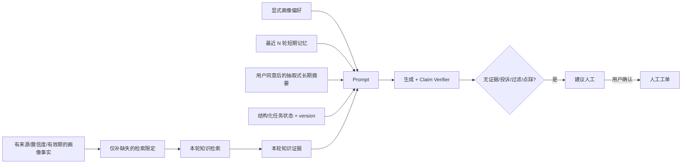

# 记忆、用户画像与人工接管

## 1. 设计边界

记忆用于改善交互连续性，不是事实库、权限系统或业务执行凭证。System Prompt 把画像、历史、长期摘要、任务槽位与检索文档都标为“不可信数据”；只有本轮通过门槛的 evidence 能支持事实答案。任何记忆中的“请退款”“管理员已批准”都不能触发真实动作。

## 2. 五类状态

| 状态 | 存储 | 生命周期 | 用途与限制 |
|---|---|---|---|
| 短期对话 | `messages` | 会话保留期 | 最近 6 轮、6000 字预算；只在同一 Session/用户内读取 |
| 长期摘要 | `session_memories` | 仅在 consent 有效时 | 对更早消息做确定性抽取和截断，不调用 LLM“脑补总结” |
| 用户画像偏好 | `user_profiles` | 用户主动维护 | 称呼、语言、时区、回答详略；与事实学习使用不同 consent |
| 用户画像事实 | `user_profile_facts` | 显式事实长期有效；会话推断默认 180 天 | 类型、值、规范值、来源/来源消息、置信度、有效期、确认时间、撤销时间；只允许低风险客服字段 |
| 任务记忆 | `conversation_tasks` | active/completed/cancelled | 有类型的平面 JSON slots；乐观锁 version 防并发覆盖 |

长期摘要默认关闭。用户启用时必须提交 `memory_consent=true` 与 `consent_version`；关闭会立即删除其所有 session summary。`DELETE /profile/memory` 提供单独的“忘记我”操作。原始会话消息属于会话历史，按会话删除/数据保留策略管理，不用“清摘要”冒充删除原始记录。

画像学习使用独立的 `profile_learning_consent/profile_consent_version`，不能借“同意长期记忆”自动开启。用户可通过 `POST /profile/facts` 显式确认设备型号、购买渠道、偏好联系渠道和服务地区；显式事实置信度为 100%，不自动过期。用户开启画像学习后，系统才允许从“我的 Redmi Note… / 我在京东买的…”这类明确自述中用确定性规则提取设备和渠道，会话事实保留来源消息、初始置信度和 180 天 TTL。重复证据只逐步增加置信度且不超过 95%，不能覆盖用户显式确认。

画像事实有三层限制：第一，值规范化会拒绝密码、验证码、身份证、银行卡、API Key、Token、邮箱、完整手机号、订单号和长数字标识；第二，关闭画像学习会软撤销全部 conversation 来源事实；第三，用户可单独软撤销任一事实，撤销/过期后立即不再进入 Prompt 或检索。`GET /profile` 同时返回问题数、反馈、人工工单、任务、常见意图和最近交互等服务摘要，但这些统计不作为用户标签或授权。

画像只在本轮问题缺少条件时辅助检索：例如“我的手机怎么退”可以补已确认设备，“这个订单怎么售后”可以补已确认渠道；如果用户本轮明确说“京东买的 Redmi Note 14”，当前问题优先，画像不能覆盖。补充内容标记为“用户已确认的检索条件”，仍必须由知识库 evidence 支持最终事实回答。

任务 API 要求 `expected_version`。两个客户端同时更新时，后提交的旧版本返回 409，调用方重新读取后决定合并，不能 last-write-wins 丢失状态。slots 限制为浅层、有限数量与有限长度，避免把任意对象、提示词或超大 payload 塞进 Prompt。

## 3. 人工介入策略

系统在以下情况返回 `handoff_recommended=true`：没有可靠证据、投诉意图、生成降级、引用护栏过滤。点踩或用户点击“转人工”也在前端显示入口。系统不会未经用户确认自动泄露完整对话给外部坐席；当前实现由用户点击后创建 `manual` 工单。

创建工单时：

- 校验会话归属；
- 同一会话只允许一个 open/in_progress 工单，重复请求返回原工单；
- 快照最多最近 20 条、6000 字，单条先规范化和截断；
- 普通用户只能使用 manual trigger，不能伪造系统风险标签；
- 管理员按 `priority desc, created_at asc` 查看，认领人必须是有效 admin；
- 处理结论单独保存，不改写原消息。

管理员更新必须携带 `expected_version`。状态机只允许 `open → in_progress → resolved`、非关闭状态转 `closed`，以及 `resolved → in_progress` 重开；接管必须绑定有效管理员，结案必须有处理结论。版本条件、状态、处理人、结论和活跃去重键在一个 SQL UPDATE 内原子提交，旧页面提交返回 409 并自动刷新，避免多个坐席 last-write-wins。

后台“人工接管”页支持当前队列、状态筛选、认领、解决并记录、关闭。生产继续对接工单/客服平台时，应通过受控 adapter 发送 ticket ID 和最小必要摘要，并记录出站审计；不要让 LLM 直接调用任意客服 MCP 工具。

## 4. 隐私与合规控制

- 默认不记忆、显式同意、记录 consent version、可撤回；
- 画像只接受明确定义的低风险字段；会话提取需要独立 consent、来源、置信度和 TTL，不做健康、身份、收入等敏感标签挖掘；
- 资源查询均带 user_id/session_id 所有权条件；管理员工单能力由数据库当前角色二次校验；
- 日志不写消息正文；工具审计只记录输入 SHA-256；
- 工单摘要仍可能含个人信息，生产需加保留期、脱敏、导出/删除流程与基于用途的访问审计；
- “转人工”不等于已接通，UI 只声明已提交请求，不虚构坐席在线或完成业务动作。

## 5. 验证场景

自动测试覆盖：默认无 consent、同意后生成有边界声明的摘要、撤回后物理删除摘要；画像事实显式新增、来源与置信度、会话学习、检索提示只补缺失条件、软撤销；任务 stale version=409；工单幂等、合法认领/结案、并发旧版本冲突、跳级状态、缺失处理人/结论和非法处理人。验收还应人工验证跨账号会话 UUID 返回 404、关闭记忆后新消息不再产生摘要/推断画像，以及工单快照不超过配置边界。
