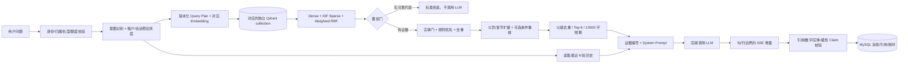

# Aegis AI 智能客服系统

本项目结合既有 FastAPI、分布式服务与推理部署经验完成，并使用 OpenAI Codex 辅助实现、测试设计和交叉审计。核心 RAG 链路、灰度路由、一致性约束与质量门均以仓库代码和可重复测试为准；模型微调、目标 GPU 参数、外部业务 MCP 和平台级高可用等未在本地环境实测的能力明确保留为生产集成边界，不以设计稿冒充已上线能力。
## 1. 项目定位

Aegis 是一个可本地一键运行的前后端分离智能客服系统，覆盖“账号—独立会话—文档入库—父子层级检索—条件式重排—LLM 流式生成—结构化证据—反馈—管理统计”的完整链路。设计原则是：**没有可靠证据就不回答；回答必须能回到原始知识片段。**

项目同时实现了意图标注、相关追问、多知识库全局检索、知识文档增量入库、规则优先上下文编排和回答引用校验。默认离线模式不需要 API Key，便于面试验收；生产模式可切换到 OpenAI 或其他 OpenAI 兼容服务。

## 2. 技术选型与原因

| 层 | 选型 | 原因 |
|---|---|---|
| 前端 | React 19 + TypeScript + Vite | 类型约束清晰、流式状态更新直接、生产构建轻量 |
| 后端 | FastAPI + Pydantic + SQLAlchemy 2 | 原生异步流、OpenAPI、输入校验成熟；持久层可在测试 SQLite 与生产 MySQL 间切换 |
| 业务库 | MySQL 8.4 | 事务、唯一约束、行级并发更新和成熟运维能力适合用户/会话/消息元数据 |
| 向量库 | Qdrant 本地/外部集群适配 | 本地模式零依赖验收；生产通过 URL/API key/gRPC 连多节点集群，payload filter 支持按库路由和按文档删除 |
| LLM | OpenAI 兼容 Chat Completions；当前真实演示为 DeepSeek | 同一 Adapter 可连接 DeepSeek、OpenAI、vLLM、OpenRouter、Ollama；后端直接转发 token stream |
| Embedding | Stable `text-embedding-v4/512`；Canary `qwen3.7-text-embedding/512`；离线 `local_hash` | 两套百炼模型已真实评测，分别绑定独立 collection；离线实现确定性强，适合 CI 但不冒充生产语义模型 |
| Rerank/多模态 | 百炼 `qwen3-rerank` / `qwen3-vl-flash` | 原生重排减少 JSON 生成开销；视觉用于图片与扫描 PDF 的受限转写，均有真实能力探针 |
| 流协议 | POST + SSE | 单向增量回答足够，代理兼容性好；POST 可以携带会话、问题与知识库路由参数 |
| 密码/认证 | Argon2 + HS256 JWT | 使用内存困难哈希，短期无状态访问令牌便于前后端分离；所有资源仍做服务端归属校验 |

没有引入 LangChain/LlamaIndex。切片、embedding、检索、重排、上下文预算、Prompt、生成、引用持久化都在 `backend/app/services` 中显式实现，便于审计每一步。

## 3. 整体 AI 架构

详细 Prompt 与阈值见 [AI架构设计](docs/AI架构设计.md)，数据关系见 [数据库设计](docs/数据库设计.md)。

## 4. AI 工程问题与处理

### 检索为空

召回结果必须通过距离或词法命中之一。全部失败时直接返回统一兜底，不向 LLM 发送“请凭空回答”的请求。这同时节省费用并消除空上下文幻觉。检索服务自身异常与真正“没有知识”分成 `RETRIEVAL_UNAVAILABLE` 和 `empty` 两种状态，不把基础设施故障伪装成业务无答案。

### 上下文超长

系统只携带最近 6 轮且最多 6000 字符历史。知识侧以最多 900 字子块检索；Stable 在一次 Qdrant batch 中执行原问题 dense 与 IDF sparse Top-12，Canary 可将原问题和最多两条审核过的扩展分别 Embedding 并召回 Top-20。各通道用 `weight/(60+rank)` 做 Weighted RRF，扩展查询共享 0.75 总权重，避免查询越多得分越高。候选还要经过实体/领域门、关键规则保护和近重复抑制，随后可调用独立熔断的 Reranker。最终最多 6 条、受 12,000 字符硬预算控制；长父块以命中子块为中心截窗，而不是总取章节开头。

### 幻觉与提示词注入

- 文档内容被包在 `<evidence>`，System Prompt 明确将其视为不可信数据，拒绝执行文档中的指令。
- 每条证据分配 `[S1]` 等白名单编号，要求事实结论逐条引用。
- 关键规则单独标记并优先放在上下文前部；冲突资料要求并列呈现，不允许模型自行裁决。
- 生成流在给用户发 token 之前按句/行缓冲；Claim Verifier 不只检查引用 ID，还校验数字/单位、产品实体、危险动作极性和原文词项支持，未通过的事实段直接过滤；最终不足时追加逐句引用的证据抽取答案。
- 引用即使被网络拆成“句号”和后续 `[S1]` 两个流块，也会等待完整后缀再验证；完成事件只输出带证据 ID 的结构化 Claims，并标注 supported/partial/unsupported。
- 模型不能声称已实际退款、下单或联系人工，避免把自然语言回答误当成业务动作。

上述主张、算法参数、失败路径和评分项证据集中见 [Question.md 评审导读](docs/Question评审导读.md)。

### 大量规则与注意力稀释

代码中的机制不是简单“多塞几段”：入库时识别“必须/不得/上限”等规则强度；检索后保证高度相关的关键规则至少占一个席位；近重复去除；关键规则优先排列；最终引用校验。验证方式包括“通用说明与限制规则同时召回”“相互冲突规则”“大量近重复片段”“问题只命中低优先说明”四类对抗集，分别观察规则召回率、引用精确率、拒答准确率和答案冲突披露率。

### 准确性与速度权衡

语义向量与 BM25-style sparse 在 Qdrant 并行检索，避免专有型号只靠 Embedding；Query Rewrite 使用已评审确定性映射，不增加一次 LLM 调用；Rerank 仅在候选足够且复合/歧义时调用，失败保留确定性顺序。完全相同问题的 Query Embedding 用 SHA-256 键、TTL、有界 single-flight 缓存，但不缓存检索结果，知识增删立即生效。

### 双套灰度

LLM model、Embedding、Prompt、RAG、vLLM service 可独立灰度。租户/用户/Conversation 白黑名单与 Intent 规则优先，其他请求使用 `tenant_id + conversation_id + axis` 的 HMAC 稳定桶；会话首轮版本持久化，不能第一轮 Stable、第二轮 Canary。Embedding 版本包含模型、维度和物理索引，Canary 失败只回退 Stable 全套。Shadow 不返回用户、不写记忆、不执行副作用；错误率、Timeout、工具失败率或 TTFT 超门会自动 Kill Switch。

## 5. 核心业务保障

- 问题长度后端按 Unicode 字符硬限制 500，前端计数只是体验提示。
- 每日 100 次由 `(user_id, usage_date)` 唯一键和条件 `UPDATE` 原子递增；并发请求不能先读后写突破上限。
- 文档状态覆盖 `processing/ready/failed/deleting/delete_failed`；分布式入库有租约、退避、dead 状态与过期 worker 围栏。
- 只有显式 consent 后才建长期摘要；画像和任务从不作为事实/授权。无证据、投诉或护栏过滤时推荐人工，用户确认后才建工单。
- 引用保存文档名与摘要快照；原文档删除后 `document_id` 置空，历史会话仍可解释当时来源。
- SSE 每 12 秒发心跳，Nginx 禁止缓冲；客户端中断时保存已生成的部分回答并标记 `interrupted`。
- 文档使用随机存储名，阻止路径穿越；限制扩展名、文件大小、PDF magic 与解析后字符数。
- 普通用户不能访问知识管理和全局统计；会话、消息、反馈都通过所属用户关联查询。

## 6. 使用 AI 编程工具的体会

本项目使用 OpenAI Codex 作为编程协作工具，用于实现、测试设计、故障审计和文档交叉检查；运行时通过 OpenAI Python SDK 的兼容协议接入 DeepSeek 生成服务，并通过阿里百炼验证 `text-embedding-v4`、`qwen3.7-text-embedding`、`qwen3-rerank` 与 `qwen3-vl-flash`。单元/API 自动测试使用 mock/local_hash，不依赖外部 Key；真实模型探针和 30 例消融单独运行，报告只保存模型/版本/指标，不保存密钥。真实 Key 仅位于被忽略的 `.env` 或加密 Provider 表，不写入仓库。

AI 生成代码不能直接等同于工程完成。本次在 RAG 链路中做了这些人工化审查和修正：

1. 把“Top-K 直接塞入 Prompt”改成置信门、混合重排、规则优先、去重与字符预算。
2. 将文档视作不可信输入，增加证据边界和提示词注入约束，而不是只写“请根据资料回答”。
3. 将引用从前端临时数据改成数据库快照，并修正为文档删除后可保留历史引用。
4. 真实测试发现可空 email/phone 直接参与 `OR` 会误判其他账号重复，改成只查询实际提供的身份字段。
5. 补齐 Windows 的 IANA `tzdata`，保证每日额度业务时区在不同操作系统一致。
6. SSE 测试按事件重新拼接 token，避免错误假设一个网络块就是一段完整文本；前端实现增量 decoder 和残留 buffer。
7. 识别到“新会话 ID 更新”可能触发组件 effect 中断正在进行的首轮流，增加流式期间不重载会话的保护。
8. 依赖审计发现 Chroma 最新版仍被安全数据库标记远程模型加载漏洞；即便本项目嵌入式用法不暴露该攻击路径，仍将向量层迁移为 Qdrant 本地模式，消除已知供应链告警，并重新跑完回归和冒烟测试。
9. 先将评估方案从 12 条扩展到 20 条可执行黄金用例；切换小米客服语料后扩为 30 条困难集，加入同品牌未知产品、提示词注入、内部信息索取、近邻混淆、父块尾部事实及口语问法，均通过修正检索、输入护栏或语料表达解决，没有放宽核心召回与拒答质量门。
10. 引入“小块召回、父级补全、条件重排、类型化证据状态”；测试进一步捕获并修复了尾随引用跨网络分片时的误过滤。
11. 公开链路验收时发现 PowerShell 默认字符串编码会把中文问题损坏为零向量，因此部署冒烟脚本改用显式 UTF-8 字节并校验答案必需词；同次检查也把离线生成从“固定摘要拼接”改为问题相关原句抽取，消除了有引用但答非所问的假通过。
12. 分布式故障注入发现 job 状态虽有 fencing token，向量写入仍可能跨租约重叠；增加 MySQL 文档级 advisory lock、等待期间续租和写入前/提交前 fence 校验，并用“写完向量后被新 worker 抢租约”的测试证明旧 attempt 无法提交。
13. 拆分生成与 embedding 的 endpoint/key，避免生产把 `/v1/embeddings` 发给聊天 vLLM；同时将 SSE 的 `done/error` 固化为终止不变量，修复无终止帧 EOF 导致前端永久 loading 或误把半截回答当成功的问题。
14. 故障恢复审计发现熔断冷却到期会同时放行排队请求，且探针失败不会立即重开；改为单探针半开态、调用代际隔离，并处理探针取消和旧慢请求迟到。人工工单则补齐 version 条件更新、合法状态机和处理人/结论约束，阻止多坐席覆盖。
15. 速度测试从“整体下载耗时”改成真实逐帧 SSE，分别测来源就绪、首 token 和完整响应；随后移除每问一次的 Qdrant exact-count 往返，并为完全相同问题加入哈希键、TTL 有界、single-flight 的 query embedding 缓存。缓存不保存召回结果，文档更新仍即时生效。
16. 真实百炼 512 维评测暴露“同品牌但错误产品”语义近邻，新增产品/业务实体一致性门和确定性口语 Query Rewrite；Stable、Canary 与 Canary+Rerank 的 30 条用例均通过后仍保持百分比为 0，避免用小样本直接宣称可全量上线。
17. 将 LLM、Embedding、Prompt、RAG、推理服务拆成独立灰度轴，并把 Embedding 模型/维度/collection 原子绑定；补充租户/用户/Conversation 路由、Shadow、副作用 Mock、自动回滚、变更审计和管理员数据访问审计。
18. 用户画像从少量偏好字段升级为带单独学习 consent 的事实账本：事实有类型、来源消息、置信度、有效期、确认时间和软撤销；只允许低风险客服字段，并拒绝密码、验证码、证件、银行卡、密钥、邮箱和完整手机号。
19. 测试发现“合法 `[S1]` 仍可引用错误数字或反向安全动作”，因此把引用白名单升级为 Claim Verifier；结构化 Claim 现在同时返回精确 `supporting_spans`，让引用编号能回到支持原句。
20. 将 Stable/Canary RAG 从仅参数差异升级为带 SHA 的策略注册：Stable 单查询混合检索，Canary 多查询 Weighted RRF；Qdrant sparse 启用 collection IDF，索引 schema 升至 4，并修复长父块前缀截断会丢失末尾命中子块的问题。

体会是：AI 很擅长扩大实现速度和测试面，但成熟度来自明确的不变量、失败补偿、真实运行反馈以及对跨层语义（数据库 NULL、代理缓冲、浏览器分片）的逐项验证。

## 7. RAG 质量评估

`backend/evaluation/rag_cases.json` 提供 30 条版本化小米客服困难用例，`python -m scripts.evaluate_rag` 复用线上 Query Planner、Qdrant Hybrid/weighted RRF、规则门、可选 Rerank 与上下文打包，不调用答案生成模型，并以非零退出码守住 CI。真实 Stable `text-embedding-v4/512`、Canary `qwen3.7-text-embedding/512` 及 Canary+`qwen3-rerank` 均通过质量门；完整报告保存在 `backend/evaluation`。未收录的汽车保险、电视安装费、提示词注入和内部信息索取必须拒答。

这组小样本用于证明评测机制可执行、捕获检索回归，不代表生产语义质量。真实模型上线前仍应扩充到 30—50 条以上带标准来源的问题，并记录：

- Context Recall：标准证据是否进入最终片段；
- Citation Precision：答案引用是否真正支持相邻结论；
- Faithfulness：答案事实是否都可由上下文推出；
- Refusal Accuracy：无答案问题是否正确拒答；
- 首 token 延迟、完整耗时与失败率。

上线阈值建议：关键规则召回率 ≥ 95%、引用准确率 ≥ 95%、无知识拒答准确率 ≥ 98%。当前 30 条结果只作为离线检索代码回归证据；目标 LLM 的答案忠实度、引用精度与幻觉率仍须另行评审。评估方案见 [AI 架构设计](docs/AI架构设计.md#8-质量评估与阈值调优)。

## 8. 已知边界与演进

- 离线 hash embedding 是词法特征哈希，不能替代生产语义模型。
- 本地 Qdrant 仍只适合单进程验收；生产参考已切到外部 Qdrant，但副本、快照和跨故障域需由目标平台实际配置和演练。
- 应用已用 MySQL HMAC 账号桶实现跨 Pod 防爆破且不保存原始身份；生产入口仍需增加 IP/设备维度限流，JWT 需要配套刷新与吊销机制。
- PDF 已支持低文本页多模态转写，但不等价于完整 OCR/表格结构化；公网不可信文件仍需独立 AV/CDR 沙箱。
- 在线 Claim Verifier 已覆盖引用白名单、数字/单位、产品实体、危险动作极性和词项支持，但仍是确定性快速守门；更复杂的事实蕴含需目标模型标注集、独立 NLI/verifier 与人工抽查。
- 当前 Provider 密钥已支持应用层加密与审计，但完整合规仍依赖 KMS/Vault、法定留存期、数据主体流程、第三方 DPA 以及外部 WORM/SIEM；详见 `docs/数据安全与合规治理.md`。

## 9. 文档导航

- [运行指南](运行指南.md)
- [API 文档](docs/API文档.md)
- [数据库设计](docs/数据库设计.md)
- [AI 架构设计](docs/AI架构设计.md)
- [业务流程说明](docs/业务流程说明.md)
- [AI Agent 任务拆解设计](docs/AI%20Agent任务拆解设计.md)
- [Prompt 优化与负反馈飞轮](docs/Prompt优化与负反馈飞轮.md)
- [Question.md 评审导读与设计闭环](docs/Question评审导读.md)
- [数据安全与合规治理](docs/数据安全与合规治理.md)
- [安全说明](SECURITY.md)

## 二次开发说明
- 项目在模型微调部署层面目前空白，值得添加这个模块，如有需求，配合推荐算法，可以尝试实现自训练。
- 项目的vllm和k8s管理并不成熟，但框架初显，也是很值得推进的地方
- 项目并未完美适配中国互联网输出内容规范，如要商用，请往此优化。
- 项目并未采购复杂的Multi-Agent，这是错误的路线，在过往的项目中，成熟的Multi-Agent其实性能浪费了，Multi-Agent会带来大量的路由算法转模型Adapter工程量。
- 支付调度以及短信验证未做，是商用MVP的第一步。
- flask以及ollama存在流量瓶颈问题，请不要使用，与项目的整体倾向不搭。
- 项目抛弃了成熟的失败成功经验沉淀，如果要走向知识图谱，请添加此步。
